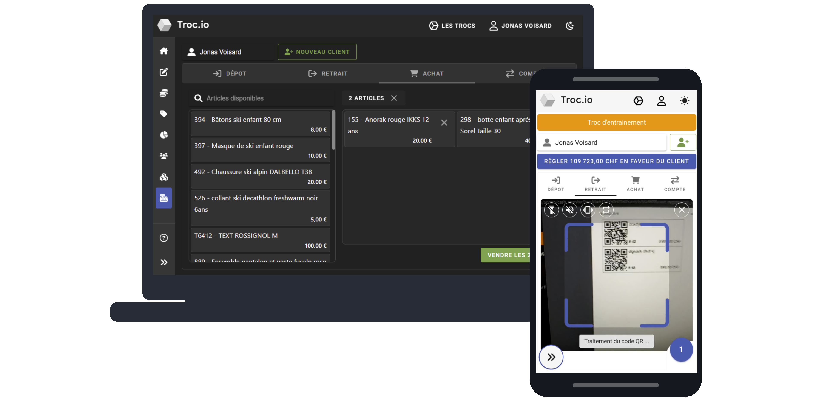

# Trocio

Plateforme pour l'organisation et la gestion de commerces éphémères.

> 👉 [Accéder à troc.io](https://troc.io)

> 👉 [Voir la roadmap](https://github.com/users/peufo/projects/5)



## Installation de l'environement de développement

Crée un fichier `.env` minimal qui écrase les valeurs de `config.ts`

```zsh
cp .env.example .env
```

Le serveur de dev tourne en HTTP. Pour scanner avec la caméra d'un téléphone
via l'IP locale, il faut du HTTPS : crée les certificats avec
[mkcert](https://github.com/FiloSottile/mkcert) puis lance `npm run dev-https`.

```zsh
npm run certs            # crée les certificats (localhost + IP locale)
npm run certs -- renew   # les recrée (ex: changement d'IP)
npm run certs -- info    # domaines et date d'expiration
npm run certs -- remove  # les supprime
```

Si Docker est dispo:

```
docker-compose up
```

Sinon:

1. Installe les dépendances
2. Assures-toi que [ton serveur MongoDB](https://www.mongodb.com/try/download/community) est disponible
3. Démarre le serveur de dev

```zsh
npm install
npm run dev
```
